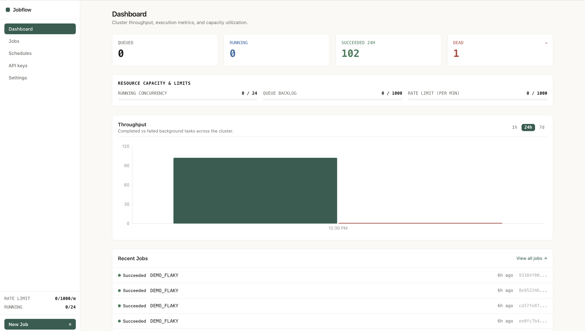
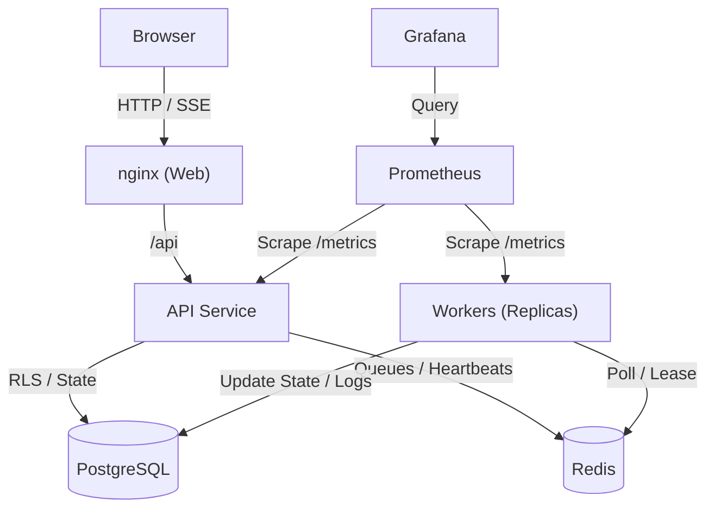

# Jobflow

Jobflow is a multi-tenant background job orchestration platform providing reliable asynchronous task processing, priority queues, recurring cron schedules, dead-letter recovery, and real-time execution monitoring via Server-Sent Events (SSE).

## Screenshots


*Jobflow web dashboard with real-time throughput, status tiles, and recent jobs.*


*Grafana monitoring dashboard showing cluster health, worker pool metrics, and queue depths.*

## Architecture



## Running the Platform

1. Copy the environment configuration template to the deploy directory:
   ```bash
   cp .env.example deploy/.env
   ```
2. Edit `deploy/.env` with your secure credentials and JWT secrets.
3. Start all services using Docker Compose:
   ```bash
   cd deploy && docker compose up --build
   ```

- **Web Application**: [http://localhost](http://localhost)
- **API & Swagger UI**: [http://localhost:8080/swagger-ui.html](http://localhost:8080/swagger-ui.html)
- **Grafana Dashboards**: [http://localhost:3000](http://localhost:3000)

## API Overview

| Endpoint | Method | Description |
| :--- | :--- | :--- |
| `/auth/register` | POST | Register a new tenant account |
| `/auth/login` | POST | Authenticate and obtain an in-memory access token |
| `/auth/refresh` | POST | Refresh access token using httpOnly cookie |
| `/auth/logout` | POST | Invalidate current session and clear cookie |
| `/me` | GET | Current tenant profile, limits, and real-time usage |
| `/me/password` | POST | Update tenant account password |
| `/me/webhook-secret/rotate` | POST | Rotate tenant webhook signing secret |
| `/keys` | GET, POST | List active API keys or generate a new raw key |
| `/keys/{id}` | DELETE | Revoke an API key |
| `/jobs` | GET, POST | List jobs with filters or dispatch a new background job |
| `/jobs/types` | GET | List known job types across the tenant |
| `/jobs/{id}` | GET, DELETE | Retrieve details or delete a finished job |
| `/jobs/{id}/executions` | GET | Retrieve attempt execution history |
| `/jobs/{id}/cancel` | POST | Cancel a queued task |
| `/jobs/{id}/retry` | POST | Retry a dead, cancelled, or retrying job immediately |
| `/jobs/requeue-dead` | POST | Bulk requeue all dead jobs |
| `/stats/summary` | GET | Summary counts, 24h success rate, and duration metrics |
| `/stats/timeseries` | GET | Throughput activity for 1h, 24h, or 7d intervals |
| `/schedules` | GET, POST | List or create recurring cron schedules |
| `/schedules/preview` | GET | Calculate upcoming execution timestamps for a cron expression |
| `/schedules/{id}` | PATCH, DELETE | Update or delete a recurring schedule |
| `/events` | GET | Server-Sent Events stream for real-time job status updates |
| `/admin/users` | GET, PATCH | Admin: View and update tenant quotas and status |
| `/admin/workers` | GET | Admin: Monitor worker node heartbeats and active loads |
| `/admin/queues` | GET | Admin: Inspect Redis priority queue depths and status metrics |

## Plug in your own jobs

Jobflow allows registering custom HTTP endpoints under `/api/endpoints` to trigger external workloads using the `CALL_ENDPOINT` job type.
- **Payload format**: `{"endpoint": "<name>", "data": {...}}`.
- **Authentication & Integrity**: Requests sent to endpoints include an HMAC-SHA256 signature header `X-Jobflow-Signature: sha256=...` signed with the tenant's webhook secret, along with `X-Jobflow-Job-Id` and `Idempotency-Key` headers matching the job ID.
- **Delivery semantics**: Delivery is at-least-once. Endpoints should inspect the `Idempotency-Key` header and ensure their execution handlers are idempotent.

## Limitations

- Access tokens are stored in memory and are short-lived; refresh tokens require httpOnly cookies with appropriate domain configuration.
- Worker task timeouts default to 60 seconds unless explicitly configured per job (up to 3600 seconds).
- Recurring schedule minimum trigger interval is 1 minute according to Spring 6-field cron constraints.
- Real-time event streams via SSE require proxy servers to disable response buffering and timeouts.
- Handlers that ignore interrupts still occupy a thread, but their lease expires and the reaper recovers the job.
- Jobs are served round-robin per user within each priority, and after upgrading, ids left in the old q:high/q:normal/q:low keys are ignored and re-added by the reconciler within about 90 seconds.
- Webhooks retry up to 8 times with backoff, then are marked FAILED.
- HTTP_CALL headers and body are encrypted at rest with PAYLOAD_KEY and shown as [hidden], other payload fields are plaintext so do not put secrets there.

## What I would change at 100x scale

Per-tenant queues with round-robin fairness already exist, so next:
- Move heartbeats from PostgreSQL to Redis with periodic sync
- Read replicas for the dashboard
- Redis with a replica and failover
- Kafka for ingestion
- Keyset pagination

## Load Test Results

| Workers | Threads Each | Throughput (jobs/min) | p95 Queue Wait | Error Rate | Duplicate Executions | Machine |
| :--- | :--- | :--- | :--- | :--- | :--- | :--- |
| | | | | | | |
| | | | | | | |
| | | | | | | |
| | | | | | | |
