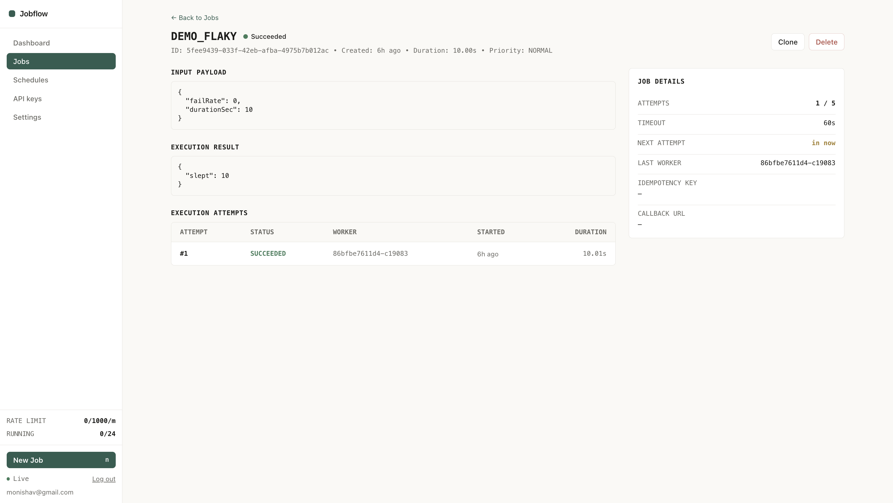
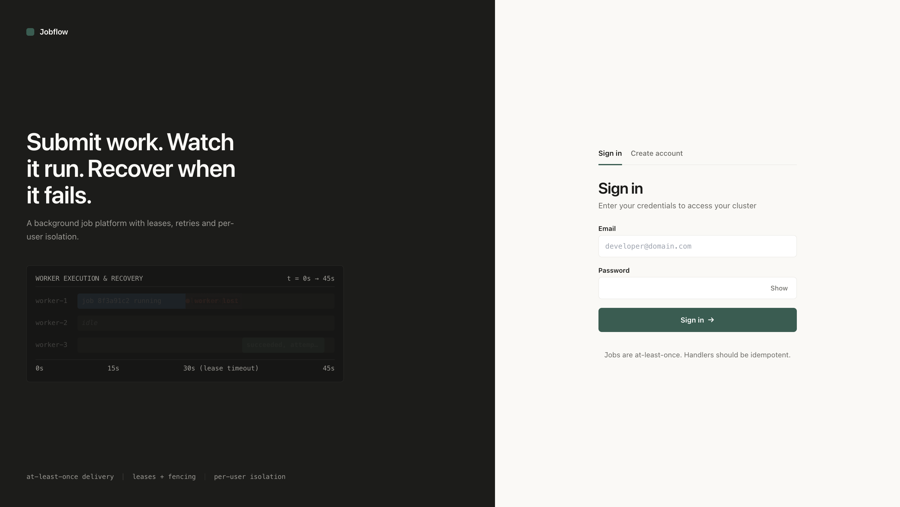
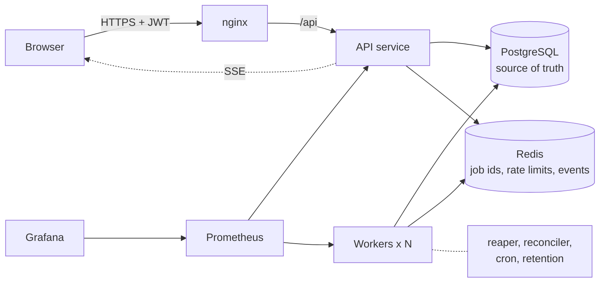
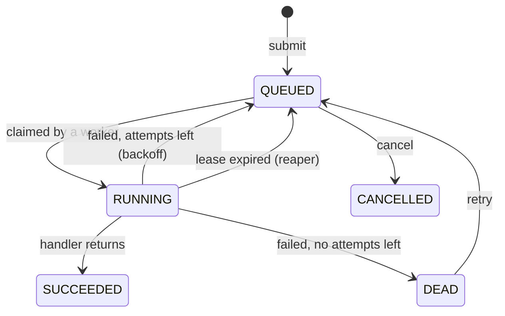

<h1 align="center">Jobflow</h1>

<p align="center">
  A multi-tenant background job platform built from scratch: submit work, run it on a pool of workers,<br>
  retry failures, survive worker crashes, and watch it all live.
</p>

<p align="center">
  
  
  
  
  
  
</p>

<p align="center">
  
</p>

## What it is

Jobflow is a distributed job scheduling and monitoring platform in the spirit of Sidekiq, Celery and Google Cloud Tasks. Signed-in users submit jobs;
independent worker processes claim and run them; failures are retried with growing delays; and if a worker dies mid-job, another worker finishes it.
Every user sees only their own data.

It focuses on the hard parts of background processing: leases, fencing, retries, fair scheduling and tenant isolation.

<table>
  <tr>
    <td width="50%"></td>
    <td width="50%"></td>
  </tr>
  <tr>
    <td align="center"><sub>Job detail: input payload, execution result and per-attempt history</sub></td>
    <td align="center"><sub>Sign in</sub></td>
  </tr>
</table>

## Features

- **Reliable execution:** atomic claim, leases with heartbeats, fenced writes, a reaper for dead workers and a reconciler that rebuilds Redis.
- **Retries:** exponential backoff with jitter (5 s doubling, capped at 15 min), then a dead-letter state a human can inspect and requeue.
- **Fair sharing:** priority queues, per-user rate limits, queue and running caps, and round-robin scheduling between users.
- **Isolation:** identity from the token only, ownership in every query, PostgreSQL row level security, and `404` instead of `403` so ids can't be probed.
- **Bring your own jobs:** register a web address once, then submit jobs that call it, signed with HMAC and carrying an idempotency key.
- **Scheduling:** delayed jobs, cron schedules, signed completion webhooks with retry.
- **Live UI:** server-sent events update statuses in place. Dashboard, jobs table, job detail, schedules, API keys, settings and an admin view.
- **Observability:** Prometheus metrics, a Grafana dashboard, structured JSON logs with job and owner ids.

## Architecture



The same Spring Boot app runs in two profiles. The **API** handles auth, validation, quotas and reads, and never runs jobs.
**Workers** claim ids from Redis, win the row in PostgreSQL, run the handler, and heartbeat a lease. PostgreSQL is the truth;
Redis holds only job ids, so losing it loses nothing permanent.

### Job lifecycle



## What can go wrong, and how it is handled

| Problem | Mechanism |
|---|---|
| Two workers take the same job | Atomic Lua claim in Redis, then a conditional `UPDATE ... WHERE status='QUEUED'`. The database transition is the final gate. |
| A worker dies mid-job | The lease lives in PostgreSQL. When heartbeats stop, the reaper re-queues the job or marks it dead. |
| A slow worker comes back after reassignment | Fencing: its final write carries worker id and attempt number, matches zero rows, and is dropped. |
| A job keeps failing | Backoff with jitter, then a dead state instead of infinite retries. |
| Redis restarts or loses data | The reconciler re-adds any queued job that is missing from Redis. |
| App crashes between the DB write and the queue push | Same reconciler. Nothing is ever only in Redis. |
| A double click or client retry | `Idempotency-Key` header. Same key and body returns the original job; a different body returns `422`. |
| One user floods the system | Rate limit, queued cap, running cap, a cap on queued high-priority jobs, and per-user round-robin. |
| A handler ignores its timeout | The heartbeat stops after the timeout plus a grace period, the lease expires, and the reaper recovers the job. |
| Secrets in job data | `HTTP_CALL` headers and body and endpoint headers are encrypted at rest (AES-GCM) and shown as `[hidden]`. |

Delivery is **at-least-once**, the standard guarantee for distributed queues, so handlers are written to be idempotent. Every call to a registered endpoint carries the job id as an idempotency key.

## Tested scenarios

Exercised end to end on the Docker Compose stack (3 workers, 8 threads each):

| Scenario | Result |
|---|---|
| Kill a worker mid-job | The reaper re-queued the job after the 30 s lease expired, another worker finished it, 2 attempts, first attempt recorded as `LEASE_LOST` |
| A job that always fails, `maxAttempts` 2 | Retried with backoff, then moved to `DEAD` with both attempts in the history |
| A 100-job burst from one user | All jobs completed across the workers |
| A second user submits during that burst | Their job started within seconds instead of waiting behind the burst |
| 22 high-priority submissions from one user | 20 accepted, the rest rejected with `429` |
| A job with a secret header | API returns `[hidden]`, database holds only encrypted text |

Integration tests (Testcontainers) cover isolation between users, retry to dead, idempotency, validation and an exactly-once run of 200 jobs: `cd backend && mvn verify` (needs Docker).

## Quick start

Requires Docker.

```bash
git clone https://github.com/monishhaa/JobFlow.git
cd JobFlow
cp .env.example deploy/.env      # then edit the values
cd deploy
docker compose up --build
```

Generate the secrets in `deploy/.env` with `openssl rand -hex 32` (for `JWT_SECRET`) and `openssl rand -base64 32` (for `PAYLOAD_KEY`).
Set `ADMIN_EMAIL` and `ADMIN_PASSWORD` to get an admin account on first start.

| Service | URL |
|---|---|
| App | http://localhost |
| API docs (Swagger) | http://localhost:8080/swagger-ui.html |
| Grafana (admin / admin) | http://localhost:3000 |
| Prometheus | http://localhost:9090 |

Everything is bound to `127.0.0.1`. The first build takes a few minutes while Maven downloads dependencies.

## Plug in your own jobs

1. Register an endpoint once (Endpoints page, or `POST /api/endpoints`): a name, a URL, and optional secret headers.
2. Submit jobs by name: `{"type": "CALL_ENDPOINT", "payload": {"endpoint": "send-welcome-email", "data": {...}}}`.
3. Jobflow calls your URL with your data, retries on failure, and recovers if a worker dies.

Each call carries `X-Jobflow-Signature` (`sha256=` HMAC of the body with your webhook secret) and `Idempotency-Key` (the job id). Verify the signature and de-duplicate on the key.

Built-in job types are `CALL_ENDPOINT`, `HTTP_CALL`, `SEND_EMAIL` (simulated), `GENERATE_REPORT` (sample CSV) and `DEMO_FLAKY` (waits, then fails randomly; for trying out retries and crash recovery).

## API

Full interactive documentation is in Swagger at `/swagger-ui.html`. The main groups are `/api/auth`, `/api/jobs`, `/api/schedules`, `/api/endpoints`, `/api/keys`, `/api/stats`, `/api/events` (SSE) and `/api/admin`.

## Tech stack

| Layer | Choice |
|---|---|
| Backend | Java 17, Spring Boot 3.3, Spring Security (JWT, rotating refresh tokens), JDBC, Flyway |
| Data | PostgreSQL 16 (truth, row level security), Redis 7 (queues, rate limits, pub/sub) |
| Frontend | React 18, TypeScript, Vite, Tailwind CSS, TanStack Query, Recharts |
| Ops | Docker Compose, nginx, Prometheus, Grafana, Jenkins pipeline, Testcontainers, k6 |

## Project layout

```
backend/    Spring Boot app: auth, job, queue, worker, recovery, schedule, endpoint, stats, admin
frontend/   React app (served by nginx in Docker)
deploy/     docker-compose, Prometheus, Grafana provisioning, Jenkinsfile
loadtest/   k6 scripts
docs/       screenshots
```

## Design trade-offs

- **At-least-once delivery** rather than exactly-once: a job may run twice after a crash, so handlers are idempotent and receive the job id as a dedupe key.
- **PostgreSQL is the source of truth, Redis is a speed layer:** a single Redis is not a correctness risk, since the reconciler rebuilds it.
- **Lease heartbeats are written to PostgreSQL:** simple and durable at this scale; the scaling path below moves them to Redis.
- **Outbound calls are checked against private and metadata addresses** before connecting, and re-checked on every redirect.
- **Access tokens are short-lived (15 minutes);** refresh tokens rotate and are revoked immediately on logout or password change.

## Scaling path

Move heartbeats to Redis with periodic sync, add read replicas for the dashboard, run Redis with a replica and failover, put Kafka in front for ingestion, and switch to keyset pagination.
